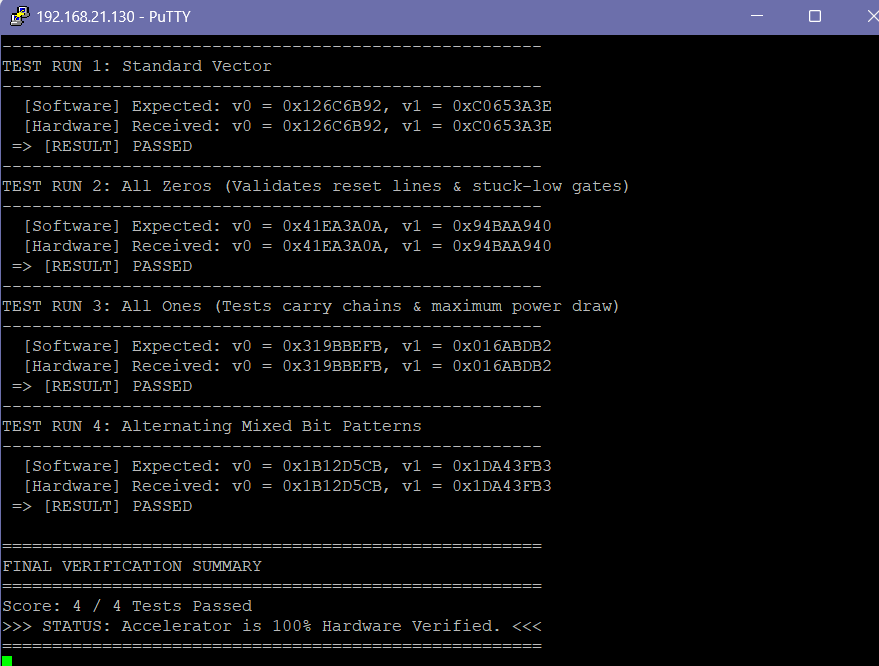

# TEA Hardware Accelerator on Zynq: AXI4-Lite SoC Integration

## Problem
Take a cryptographic core off the simulator and put it on real hardware: implement the Tiny
Encryption Algorithm (TEA) as an FPGA accelerator, expose it to the ARM Cortex-A9 side of a
Zynq SoC through a custom AXI4-Lite slave, and verify correctness by running plaintext/key
pairs through both a C software model on the processor and the hardware core over the fabric,
comparing results live.

This is the point in the course where the work stops being "does the testbench pass" and
becomes "does a real processor, talking over a real bus, get the right answer from silicon."

## Architecture
```
ARM Cortex-A9 (main.c)
        │  AXI4-Lite
        ▼
axi4_lite_slave.v  ── 33-register memory map (data + control/status)
        │
        ▼
   tea_core.v  ── 32-round Feistel-style TEA FSM
```

- **`tea_core.v`** — TEA encryption core as an explicit FSM: two states per round
  (`CALC_V0`/`CALC_V1`), 32 rounds, `sum` accumulated by `DELTA = 0x9e3779b9` each round —
  a direct hardware mapping of the reference algorithm, not a rolled-up combinational block.
- **`axi4_lite_slave.v`** — a full AXI4-Lite slave written from scratch: independent FSMs for
  the write-address/write-data/write-response and read-address/read-data channels, backing a
  33-word register file. Register map:
  - `0, 1` — plaintext words `v0`, `v1`
  - `2–5` — key words `k0..k3`
  - `32` — control register, bit 0 = `start`
  - `33` — status register, bit 0 = `done`
  - `34, 35` — result words `v0_out`, `v1_out`
  - `ledout` drives an on-board LED from a free-running counter as a visual "core is alive" heartbeat

## Verification approach
No RTL testbench here — this was verified **on real hardware** instead. `main.c` runs on the
Zynq's ARM core, drives the AXI4-Lite bus directly via `Xil_Out32`/`Xil_In32`, and for each of
4 test vectors (a general case, all-zeros, all-ones, and a mixed-bit pattern) computes the
expected result with a software TEA model *and* triggers the FPGA core over the bus, then
compares the two live, with a timeout guard against a hung core. This is closer to how a real
accelerator gets validated in practice than a simulation-only testbench — it exercises the
actual bus protocol, clock domain crossing, and physical FPGA fabric, not just RTL semantics.

The Vivado project (block design, constraints, bitstream) isn't included here since it isn't
meaningfully portable outside the RemoteFPGA/Zynq lab setup — the two RTL files and the C driver
are the parts that carry the actual design content.

## Key result
All 4 hardware/software comparisons pass, including edge cases (all-zero and all-one operands)
chosen specifically to stress carry chains and catch stuck-at faults that mid-range test
vectors wouldn't reveal.



## Files
```
hw/
├── tea_core.v          — TEA encryption FSM (32 rounds)
└── axi4_lite_slave.v   — AXI4-Lite slave + memory-mapped register file
sw/
└── main.c              — ARM-side driver: AXI register access, SW/HW cross-check, timeout handling
```
