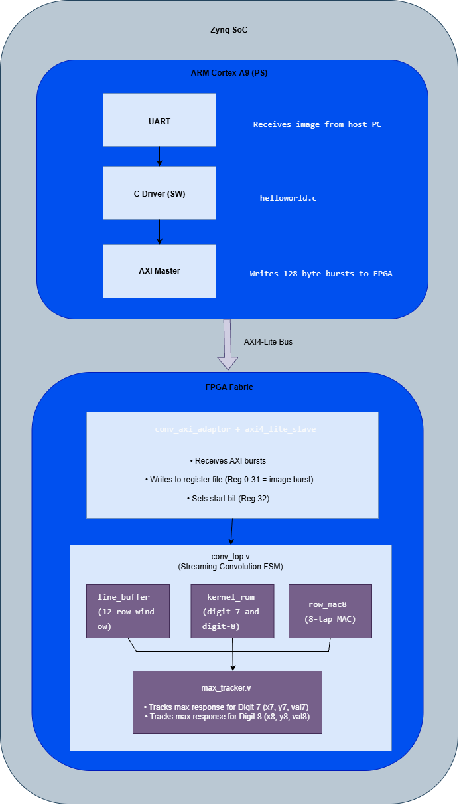
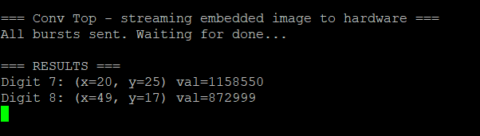

# Final Project — CNN-Style Convolution Layer for Handwritten Digit Detection on FPGA

## Problem
Implement a single convolutional layer — the kind of thing that would normally sit inside a
CNN — as a standalone streaming hardware accelerator: detect two specific handwritten digits
(7 and 8, from group number 7) inside a 64×64 grayscale image, and report each digit's
location and confidence, on an FPGA that can't hold the full image or a naive fully-parallel
convolution at once.



## Approach

**Software side (`tools/`)** — before any RTL was written, the two digit templates were
converted into convolution kernels in Python:
- `kernel.py` crops each digit template, builds a `+1`/`-1` binary kernel (digit pixels vs.
  background), and zero-mean normalizes it — a matched-filter approach, so the kernel's
  response is maximized where the input best resembles the digit shape.
- `verifyFixPoint.py` quantizes that float kernel to 8-bit signed fixed-point, measures the
  resulting quantization error against the float reference, and derives the required
  accumulator width from the actual worst-case sum (12×8 = 96 taps × 8-bit × 8-bit → 23 bits
  needed, 24-bit signed accumulator used) — sizing the hardware from the math instead of
  guessing a "safe-looking" width.

**Hardware side (`rtl/`)** — a streaming design, not a frame-buffered one, because the full
64×64 image doesn't need to (and shouldn't have to) live on-chip at once:
- **`line_buffer.v`** — maintains a rolling 12-row window as pixels stream in row-major, one
  byte per cycle; exposes an 8-pixel slice for any of the 12 buffered rows.
- **`kernel_rom.v`** — loads each kernel's fixed-point weights via `$readmemh` from
  `kernel7_neg.hex` / `kernel8_neg.hex`, one 8-tap row per cycle.
- **`row_mac8.v`** — 8-tap MAC datapath: one kernel row's dot product against one image row
  slice, per cycle.
- **`conv_top.v`** — the FSM tying it together: streams in the image, and for every valid
  12×64 window position sweeps all 57 column offsets, computing both kernels' 12×8 dot
  products in parallel (8 taps/cycle × 12 rows + 1 flush cycle per window). Total: 13 cycles ×
  57 columns × 53 rows ≈ 39.3k cycles/frame — negligible next to the UART transfer time, and
  only ~16 of the XC7Z010's 80 DSP48E1 slices used.
- **`max_tracker.v`** — tracks the running maximum convolution response (and its `(x, y)`
  coordinates) per kernel, so the final answer is just "wherever the matched filter fired
  strongest."
- **`conv_axi_adaptor.v`** + **`axi4_lite_slave.v`** — the same AXI4-Lite register-file
  approach as HW06's TEA accelerator, extended for image streaming: the image arrives 128
  bytes (32 registers) per AXI burst, and `conv_axi_adaptor` drains each burst into the
  convolution core one pixel per cycle with proper `pixel_ready` backpressure, so the ARM
  core never has to wait on the convolution — it just keeps feeding bursts.

**Register map** (`sw/helloworld.c` ↔ `axi4_lite_slave.v`):
| Reg | Meaning |
|---|---|
| 0–31 | current 128-byte image burst |
| 32 | `start` (self-clearing pulse) |
| 33 | `done` |
| 34 | `busy` |
| 35, 36, 37 | `x7`, `y7`, `val7` |
| 38, 39, 40 | `x8`, `y8`, `val8` |

## Verification
`sw/helloworld.c` streams a real 4096-byte test image (`sw/image_data.h`, generated from
`data/input-64x64.bmp`) to the board across 32 AXI bursts, waits for `done`, and prints the
detected coordinates and confidence for both digits — verified on real hardware via
RemoteFPGA/UART, the same way as the TEA accelerator.



## Files
```
rtl/
├── conv_top.v            — top-level streaming convolution FSM
├── conv_axi_adaptor.v    — AXI burst-to-pixel-stream adaptor + backpressure
├── axi4_lite_slave.v     — AXI4-Lite slave + register file
├── line_buffer.v         — rolling 12-row image window
├── kernel_rom.v          — kernel weight ROM ($readmemh)
├── row_mac8.v             — 8-tap MAC datapath
├── max_tracker.v          — running max + coordinate tracker
├── kernel7_neg.hex        — digit-7 kernel weights (8-bit signed, quantized)
└── kernel8_neg.hex        — digit-8 kernel weights
sw/
├── helloworld.c            — ARM-side driver: streams image, reads back results
└── image_data.h            — test image as a C byte array
tools/
├── kernel.py                — BMP templates -> normalized float kernels, Verilog export
└── verifyFixPoint.py         — float -> 8-bit fixed-point quantization + accumulator sizing
data/
├── input-64x64.bmp           — full test image
├── input-7.bmp                — digit-7 template (8x12)
└── input-8.bmp                — digit-8 template (8x12)
```

The Vivado project (block design, constraints, bitstream) isn't included — same reasoning as
the HW06 repo: it isn't portable outside the RemoteFPGA/Artemis Mitra lab setup, and the RTL,
kernel-generation tooling, and driver above are what actually carry the design content.
